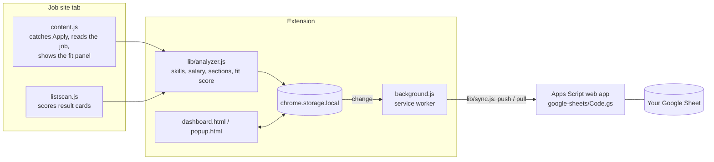

# Job Tracker

A Chrome extension that records every job you apply for, scores how well each one fits your skills, and keeps the whole pipeline (applications, interviews, offers, follow-ups) in one dashboard, with an optional two-way sync to your own Google Sheet.

I built it for my own job search in the UK, to keep track of applications spread across several job boards, know when to follow up, and see which skills kept coming up in ads.


## What it does

- **Captures applications automatically.** Press *Apply* on LinkedIn, Indeed, Reed, Totaljobs, CV-Library, CWJobs, Glassdoor or jobs.ac.uk and the job is saved with its title, company, location, salary, description and any recruiter contacts. On any other site, one click in the popup adds the page.
- **Scores fit before you apply.** A badge on the job page shows a 0–100 score and the reasons behind it: which tools in the ad you know, which you don't, seniority, years of experience, and hard constraints such as a driving licence or security clearance.
- **Scores search results.** Each card in a results list gets a badge, and a small panel filters out jobs below a minimum score, jobs you already applied to, or senior roles.
- **Tracks the pipeline.** Twelve statuses from *Applied* to *Offer accepted*, a full history per application, a weekly chart, response rate per job board, and a list of what needs attention (follow-ups due, next steps, offer deadlines).
- **Drafts follow-ups.** Email, LinkedIn note (kept under the 200-character limit) or a phone script, tailored to the job and to whether it was posted by an agency.
- **Compares offers.** Salary, pension, hours, commute time and cost, holidays and training, weighted by sliders for what matters to you, including an effective hourly rate once the commute is counted.
- **Syncs with Google Sheets.** Applications are copied to a sheet you own; status or notes changed in the sheet (on your phone, say) come back to the extension.

| Fit before you apply | Application drawer with follow-up |
| --- | --- |
|  |  |

*Screenshots use invented companies and demo data.*

## How it works



Everything runs locally. The analyser is plain JavaScript with no network calls and no model: a dictionary of around 100 tools and skills with regular expressions, a parser that splits an ad into requirements, nice-to-haves, responsibilities and benefits, and a points-based score.

### The fit score

| Part | Points | How |
| --- | --- | --- |
| Skills | up to 50 | Each tool found in the ad is weighted 1.5× if it sits under *Requirements* or next to words like *essential*, 0.5× if it is *desirable*, and half again if it is a basic that almost every ad mentions. Your level per tool (confident, basic, none) gives full, 60% or zero credit, with partial credit for a similar tool you know (FastAPI for Django, VMware for Proxmox). |
| Level | up to 20 | Intern, graduate, placement and junior titles score highest; senior, lead and principal score zero; role types you are not aiming for score low. |
| Experience | up to 15 | Years of experience asked for, read from phrases like *2+ years of commercial experience*. |
| Constraints | negative | Driving licence, security clearance, a required degree, a location outside your areas, local candidates only. |
| Bonuses | positive | Part-time or flexible hours when you work fewer than five days; a language you speak that the ad asks for. |

It is a guide for deciding where to spend time, not a prediction.

### Google Sheets sync

The service worker pushes changes a few seconds after they happen and does a full pull and push every 10 minutes and when the dashboard opens.

- **What to push.** Every write bumps a revision number on the application; the sync sends applications whose revision differs from the one it last sent. An earlier version compared timestamps, and a unit test caught that two writes in the same millisecond made the second one look already synced.
- **Conflicts.** The sheet records when a row was edited (`onEdit`). On pull, a sheet row newer than the local copy wins for the fields people edit in the sheet: status, notes, next step, salary, title, company and location. Otherwise the local copy wins and is pushed.
- **Deletes.** Deleting in the extension queues the ID and removes the row on the next push. A row deleted only in the sheet is restored, so the extension stays the source of truth.
- **Access.** The Apps Script runs as a web app. `setup()` generates a random token and keeps it in Script Properties; every request must carry it. Nothing secret is in the repository, and *Create a new sync token* in the sheet menu revokes the old one.

Known limitations: conflict resolution compares the sheet's clock with the browser's; the GET request carries the token in the query string because Apps Script web apps cannot read headers.

## Responsible use

- Your applications stay in your browser (`chrome.storage.local`) unless you connect your own sheet. There is no server and no analytics.
- The extension reads the job you have open. It never fetches LinkedIn pages in the background. Loading full descriptions for Indeed search results is an opt-in setting, rate-limited, and pauses when the site asks it to.
- It asks only for the permissions it uses: storage, the active tab and scripting (for *Add this page*), alarms (for the 10-minute sync), the supported job sites for the content scripts, and the two Google Apps Script hosts used by the sync.

## Install

1. Download or clone this repository.
2. Open `chrome://extensions`, turn on **Developer mode**, choose **Load unpacked** and select the folder.
3. The dashboard opens on **Skills & settings**: mark your level for the tools you know, tick the role types you are aiming for, and add the towns you can work in.
4. Pin the extension and open a job on any supported site.

### Connect a Google Sheet (optional, 5 minutes)

1. Create a sheet at [sheets.new](https://sheets.new) and open **Extensions → Apps Script**.
2. Replace the editor contents with [`google-sheets/Code.gs`](google-sheets/Code.gs), save, select `setup` and press **Run**. Approve the access request; it is your own script and only touches this sheet.
3. In the sheet, open **Job Tracker → Show sync token** and copy the token.
4. **Deploy → New deployment → Web app**, execute as *Me*, access *Anyone*, then copy the URL that ends in `/exec`.
5. In the extension: **Skills & settings → Google Sheet**, paste the URL and token, press **Test connection**, then **Sync now**.

### Upgrading from 1.x

Version 2.0 switched the interface from Russian to English. Saved applications, settings and backups are migrated automatically when the extension updates (`lib/legacy.js`). For the sheet, paste the new `Code.gs`, run `setup` once (it renames the old sheet and translates its statuses), create a new deployment version and copy the token from the menu.

## Development

No build step and no runtime dependencies: the extension loads the files in this folder as they are.

```bash
npm test          # 41 unit tests with node:test (Node 20+)
npm run check     # manifest references, script syntax, no committed token
```

The unit tests load the real `lib/` files with a fake `chrome.storage` (`tests/helpers/env.js`) and test the sync against an in-memory stand-in for the Apps Script web app (`tests/helpers/fake-sheet.js`). GitHub Actions runs both commands on every push.

`tests/e2e/smoke.py` loads the unpacked extension in Chromium with Playwright, seeds demo data, opens every dashboard view, captures an application from a mocked job page and fails on any console error. It also produced the screenshots above:

```bash
pip install playwright && playwright install chromium
python3 tests/e2e/smoke.py . docs/screenshots
```

### Project structure

```
manifest.json         Manifest V3
background.js         service worker: badge, auto-sync, migrations
content.js            job pages: Apply detection, extraction, fit panel
listscan.js           search results: score badges and filter panel
popup.html/js         toolbar popup
dashboard.html/js/css overview, applications, offers, settings, data
lib/analyzer.js       skills dictionary, salary parser, sections, fit score
lib/extract.js        per-site selectors, JSON-LD, contacts
lib/store.js          storage, tickets, URL normalisation, revisions
lib/sync.js           Google Sheets push / pull
lib/followup.js       follow-up templates
lib/legacy.js         migration from the Russian-language 1.x versions
google-sheets/Code.gs Apps Script web app and sheet formatting
tests/                unit tests, helpers and the browser smoke test
```

## Roadmap

- Move the analyser to TypeScript and split `dashboard.js` into modules.
- Replace keyword matching with semantic matching: a small Python (FastAPI) service that embeds the job ad and the CV, compared against the current scorer on a hand-labelled set of real ads.
- Publish to the Chrome Web Store.

## Licence

[MIT](LICENSE)
