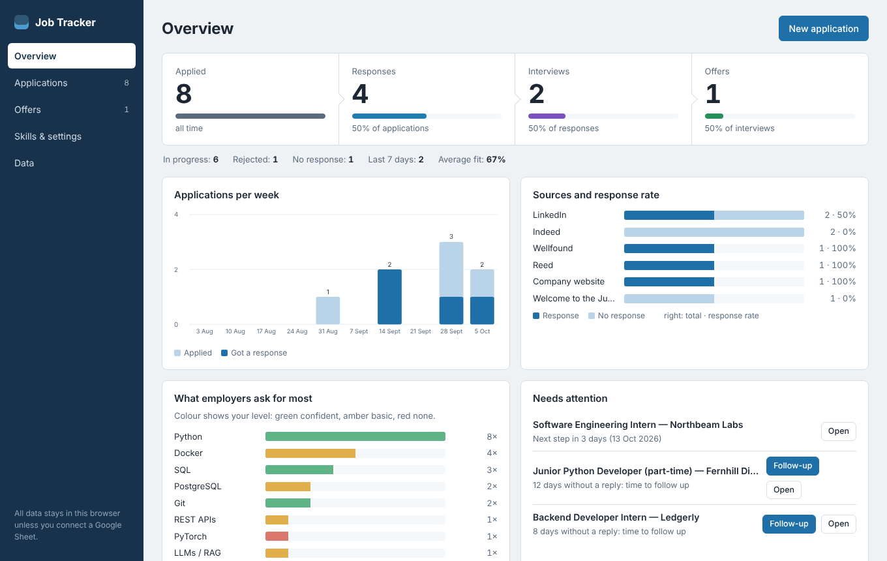
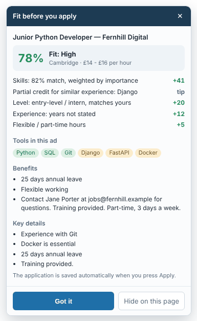
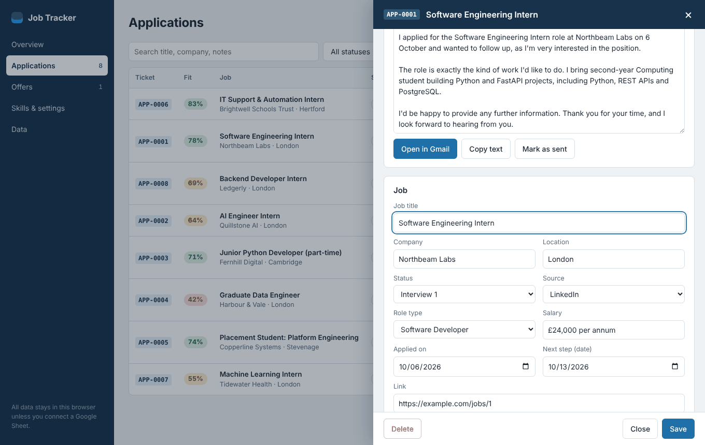
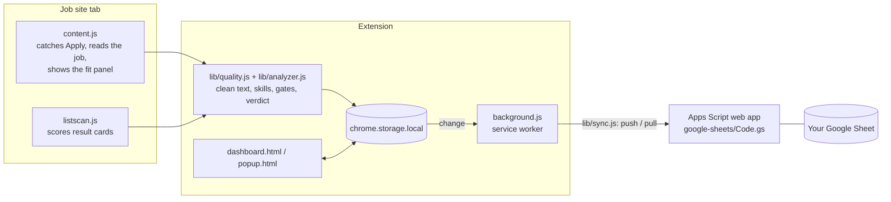

# Job Tracker

A Chrome extension that records every job you apply for, scores how well each one fits your skills, and keeps the whole pipeline (applications, interviews, offers, follow-ups) in one dashboard, with an optional two-way sync to your own Google Sheet.

I built it for my own job search in the UK, to keep track of applications spread across several job boards, know when to follow up, and see which skills kept coming up in ads.



## What it does

- **Captures applications automatically.** Press *Apply* on LinkedIn, Indeed, Reed, Totaljobs, CV-Library, IT-Jobs, CWJobs, Glassdoor or jobs.ac.uk and the job is saved with its title, company, location, salary, description and any recruiter contacts. On any other site, one click in the popup adds the page.
- **Scores fit before you apply.** A badge on the job page shows a 0–100 score and the reasons behind it: which tools in the ad you know, which you don't, seniority, years of experience, and hard constraints such as a driving licence or security clearance.
- **Scores search results.** Each card in a results list gets a badge, and a small panel filters out jobs below a minimum score, jobs you already applied to, or senior roles.
- **Tracks the pipeline.** Twelve statuses from *Applied* to *Offer accepted*, a full history per application, a weekly chart, response rate per job board, and a list of what needs attention (follow-ups due, next steps, offer deadlines).
- **Drafts follow-ups.** Email, LinkedIn note (kept under the 200-character limit) or a phone script, tailored to the job and to whether it was posted by an agency.
- **Compares offers.** Salary, pension, hours, commute time and cost, holidays and training, weighted by sliders for what matters to you, including an effective hourly rate once the commute is counted.
- **Handles internships separately.** Internships and placements get their own skills profile, target roles and score. Paste your university's placement briefing and the extension reads the rules (dates, minimum weeks, hours, days a week, remote-only for overseas companies, paid preferred, deadlines) and checks every internship against them: dates, length, hours, location, pay, relevance to the degree and whether the duties are graduate-level.
- **Reads your CV and checks it like an ATS.** Drop a PDF or Word CV and skill levels are set from it (skills section and experience count as confident; working knowledge, in progress and projects as basic). The CV gets an ATS check (readable text, contact details, standard sections, length, action verbs, numbers, tables, images, template leftovers) and every job shows which of its keywords are in your CV, which you could add honestly, and which you lack. The file is parsed in the browser and never uploaded.
- **Syncs with Google Sheets.** Applications are copied to a sheet you own; status or notes changed in the sheet (on your phone, say) come back to the extension.

| Fit before you apply | Application drawer with follow-up |
| --- | --- |
|  |  |

*Screenshots use invented companies and demo data.*

## How it works



Everything runs locally. The analyser is plain JavaScript with no network calls and no model: a dictionary of around 100 tools and skills with regular expressions, a parser that splits an ad into requirements, nice-to-haves, responsibilities and benefits, and a points-based score.

### The fit score

| Part | Points | How |
| --- | --- | --- |
| Skills | up to 50 | Each tool found in the ad is weighted 1.5× if it sits under *Requirements* or next to words like *essential*, 0.5× if it is *desirable*, and half again if it is a basic that almost every ad mentions. Your level per tool (confident, basic, none) gives full, 60% or zero credit, with partial credit for a similar tool you know (FastAPI for Django, VMware for Proxmox). |
| Level | up to 20 | Intern, graduate, placement and junior titles score highest; senior, lead and principal score zero; role types you are not aiming for score low. |
| Experience | up to 15 | Years of experience asked for, read from phrases like *2+ years of commercial experience*. |
| Constraints | negative | Driving licence, security clearance, a required degree, a location outside your areas, local candidates only. |
| Bonuses | positive | Part-time or flexible hours when you work fewer than five days; a language you speak that the ad asks for. |

It is a guide for deciding where to spend time, not a prediction.

### Verdicts (3.0)

A number alone said little: in a real backup of 100 applications, 96 scored 50% or more, including empty records and application forms that scored 73%. Since 3.0 every job gets a verdict, and the number is shown only when the data under it is real.

1. **Data quality** (`lib/quality.js`). The description is cleaned of LinkedIn and Indeed page chrome (search results, *Show match details*, *About the company*, footers). Search headings (*37,252 IT Engineer Jobs*), application forms and lists of jobs are recognised; the title is recovered from the text where possible (*Join Northwood as IT Support Engineer*). A record without a real ad gets **?** and the verdict *Incomplete*.
2. **Gates** (`checkGates` in `lib/analyzer.js`). Blocks rule a job out as you are today: a required driving licence (including a bare *Full, clean driving licence* bullet), years far above yours (*3+ years in a support role*), a 3rd-line or senior title, a contractor day rate, a language you do not speak, *local candidates only* with a place outside your areas (the place is read from the sentence, not the saved location). Asks are worth checking first: one more year than you have, 2nd line, security clearance, a degree, the commute, placement dates not stated.
3. **Verdict and confidence.** *Skip* if anything blocks; *Check first* if something needs asking or the ad names few skills; otherwise *Apply* (70+) or *Tailor CV* (45–69). Confidence (confident · fairly sure · rough guess) depends on the length of the ad and how many skills it names; a rough guess shows as ≈62%. A blocked job is capped at 25% so it sorts to the bottom.
4. **Re-check and calibration.** *Data → Re-check all* downloads a backup, then runs the current rules over everything saved: repairs titles, cleans descriptions, re-scores, marks duplicates (same link; same title and company within two weeks; the same ad text) with an optional merge that keeps notes, contacts and the furthest status, and renumbers clashing tickets. *Overview → Does the verdict work?* shows reply and interview rates per verdict, so you can see whether Apply jobs really answer more often than Skip jobs.

**Fewer, better applications (3.3).** Changes made after reading a real backup of 100 applications with no interviews:

- *Paid experience is its own number.* Settings has two figures: years you can show (freelance included) and years in a paid IT job with an employer. When the second is set, the experience gate uses it, because a CV screen for *1 year in an IT support role* usually looks for an employer. With none, *2 years required* rules a job out, *1 year* or *previous experience in an IT support role* becomes a question.
- *A ruled-out job shows ✕, not a percentage.* A 62% next to *Skip* still read as a chance.
- *Before you apply* the side panel says what to do with the verdict (tailor first, check the open questions, better not to apply) and counts what you sent today against a daily target (Settings, default 5). Nothing is blocked.
- *After you apply* the panel warns when the job was marked Skip (press Undo if you only opened the form) and asks whether you changed your CV for it. *Why no interviews?* then compares replies by verdict and by tailored versus standard CV.
- *Follow-ups are due after 4 working days*, not 7 calendar days.
- *Copy prompt for an AI chat.* In an application's *CV for this job* panel: a prompt with the ad, your CV (or optional extra facts from Settings) and rules that forbid inventing anything, to paste into Claude or ChatGPT. A cover letter needs a sentence in your own words on why this employer. Nothing is sent from the extension.
- *Internships are hidden* unless switched on in Settings; the records stay.
- Salaries written as *£26-28,000* or *£26-28k* are read as £26,000–£28,000.

**Tailor CV (3.4).** *Tailor CV* in the job panel (before you apply, nothing has to be saved) or in an application opens your CV from the CV & ATS page reordered for that ad: the ad's tools first in each skills line, the most relevant bullets first in each job, the job title as the headline (optional), and tools the ad asks for that you marked as known in Settings added on one *Also:* line (optional, highlighted). Wording is never changed and nothing is invented; tools you do not have are listed as gaps instead. Every line is editable, × removes a bullet, and the result downloads as Word (`lib/docx.js`, plain paragraphs that applicant tracking systems read well) or PDF with real text (`lib/cvpdf.js`, jsPDF). When you then press Apply on that job, the application is marked *CV tailored* with the file name.

**Why no interviews (3.2).** Every new application records *how* you applied, taken from the button you pressed (*Easy Apply*, company website, job-board form; agency, email and referral by hand), the cover letter (default in Settings) and the CV file loaded in the CV tab, how old the ad was and how many people had applied (*Reposted 2 weeks ago · Over 100 people clicked apply*, *Posted 21 October*, JSON-LD `datePosted`), and which hard demands the ad makes (previous IT experience, years, full-time, degree, driving licence, certificates, clearance). When an application is rejected the drawer asks when and why, and guesses *CV screen* for a 'no' within 3 days. *Overview → Why no interviews?* shows reply and interview rates for each of these, the share of rejections that came within 3 days, and plain-language findings. *Applied* with no reply or follow-up for 30 days (Settings; 0 = never) becomes *No response* on its own. The new fields go to Google Sheets as eight extra columns (update `Code.gs` to version 12).

**The same job on another site (3.1).** Agencies post one vacancy on CV-Library, Reed, Totaljobs and LinkedIn. Before you apply, the job panel and badge say *Already applied via CV-Library* when a saved application matches by the agency's reference (*BH37630*, *Ref: AJ47736*), by the ad text, or by title and company within 60 days; pressing Apply does not save a second record. On search results the badge tooltip says the same once the full ad is loaded.

**Journey check (3.0.8).** A place can be inside your areas and still be far from home: Orpington is London, but about 55 km from Bishop's Stortford. Set *Home town* and *Longest journey* in Settings (default: the first town in your areas, 50 km). An office-based job further away asks about the journey and scores lower; a hybrid one only gets a note.

**Wrong verdicts.** Every job panel has a *Wrong verdict?* link: pick what it should be and add a reason. *Data → Wrong verdicts* downloads them with the ad text, and `node scripts/check-feedback.js wrong-verdicts.json [backup.json]` shows which ones the current rules already get right. Each one is meant to become a unit test.

To check a rule change against your own data before shipping it, export a backup and run `node scripts/audit-export.js backup.json`: it prints the old score next to the new verdict for every application. Keep the backup outside the repository: it holds personal data.

### Google Sheets sync

The service worker pushes changes a few seconds after they happen and does a full pull and push every 10 minutes and when the dashboard opens.

- **What to push.** Every write bumps a revision number on the application; the sync sends applications whose revision differs from the one it last sent. An earlier version compared timestamps, and a unit test caught that two writes in the same millisecond made the second one look already synced.
- **Conflicts.** The sheet records when a row was edited (`onEdit`). On pull, a sheet row newer than the local copy wins for the fields people edit in the sheet: status, notes, next step, salary, title, company and location. Otherwise the local copy wins and is pushed.
- **Deletes.** Deleting in the extension queues the ID and removes the row on the next push. A row deleted only in the sheet is restored, so the extension stays the source of truth.
- **Access.** The Apps Script runs as a web app. `setup()` generates a random token and keeps it in Script Properties; every request must carry it. Nothing secret is in the repository, and *Create a new sync token* in the sheet menu revokes the old one.

Known limitations: conflict resolution compares the sheet's clock with the browser's; the GET request carries the token in the query string because Apps Script web apps cannot read headers.

## Responsible use

- Your applications stay in your browser (`chrome.storage.local`) unless you connect your own sheet. There is no server and no analytics.
- The extension reads the job you have open. It never fetches LinkedIn pages in the background. Loading full descriptions for Indeed search results is an opt-in setting, rate-limited, and pauses when the site asks it to.
- It asks only for the permissions it uses: storage, the active tab and scripting (for *Add this page*), alarms (for the 10-minute sync), the supported job sites for the content scripts, and the two Google Apps Script hosts used by the sync.

## Install

1. Download or clone this repository.
2. Open `chrome://extensions`, turn on **Developer mode**, choose **Load unpacked** and select the folder.
3. The dashboard opens on **Skills & settings**: mark your level for the tools you know, tick the role types you are aiming for, and add the towns you can work in.
4. Pin the extension and open a job on any supported site.

### Connect a Google Sheet (optional, 5 minutes)

1. Create a sheet at [sheets.new](https://sheets.new) and open **Extensions → Apps Script**.
2. Replace the editor contents with [`google-sheets/Code.gs`](google-sheets/Code.gs), save, select `setup` and press **Run**. Approve the access request; it is your own script and only touches this sheet.
3. In the sheet, open **Job Tracker → Show sync token** and copy the token.
4. **Deploy → New deployment → Web app**, execute as *Me*, access *Anyone*, then copy the URL that ends in `/exec`.
5. In the extension: **Skills & settings → Google Sheet**, paste the URL and token, press **Test connection**, then **Sync now**.

### Internships and placement rules

Open **Internships** in the dashboard, paste the placement briefing into *Placement rules* and press *Read the rules*, or fill the fields by hand. Mark which role types are a priority, a target or not a target. An application can be switched between *Job* and *Internship / placement* in its drawer or in the panel on the job page; the search-results panel can show internships only and hide those that break your rules.

| Rule check | Score for internships |
| --- | --- |
| ✓ fits · ? not stated in the ad · ✕ breaks a rule · i something to agree with the employer | skills up to 50, role up to 25, level up to 20; a broken rule on dates, location or relevance costs 25, others 8 |

### Upgrading from 2.x to 3.0

Reload the extension, then open *Data → Re-check all* once: it downloads a backup first, then gives every saved application a verdict, cleans old descriptions and fixes clashing ticket numbers. Review the duplicates it lists before pressing *Merge duplicates*. For the sheet, paste the new `Code.gs` (adds the *Verdict* column and ignores broken *Next step* dates), run `setup`, then *Manage deployments → New version*. Fit % is left empty in the sheet for incomplete records.

### Upgrading from 2.0

Replace the files and reload the extension; nothing is lost. For the sheet, paste the new `Code.gs` (adds the *Type* and *Placement rules* columns), run `setup`, then *Manage deployments → New version*. If the sheet still has the old Russian tabs next to the English ones, `setup` copies any rows that exist only in the old tab and removes the old tabs.

### Upgrading from 1.x

Version 2.0 switched the interface from Russian to English. Saved applications, settings and backups are migrated automatically when the extension updates (`lib/legacy.js`). For the sheet, paste the new `Code.gs`, run `setup` once (it renames the old sheet and translates its statuses), create a new deployment version and copy the token from the menu.

## Development

No build step and no runtime dependencies: the extension loads the files in this folder as they are.

```bash
npm test          # 95 unit tests with node:test (Node 20+)
npm run check     # manifest references, script syntax, no committed token
```

The unit tests load the real `lib/` files with a fake `chrome.storage` (`tests/helpers/env.js`) and test the sync against an in-memory stand-in for the Apps Script web app (`tests/helpers/fake-sheet.js`). GitHub Actions runs both commands on every push.

`tests/e2e/smoke.py` loads the unpacked extension in Chromium with Playwright, seeds demo data, opens every dashboard view, captures an application from a mocked job page and fails on any console error. It also produced the screenshots above:

```bash
pip install playwright && playwright install chromium
python3 tests/e2e/smoke.py . docs/screenshots
python3 tests/e2e/intern.py . path/to/cv.pdf   # placement rules, CV import, internship capture
```

### Project structure

```
manifest.json         Manifest V3
background.js         service worker: badge, auto-sync, migrations
content.js            job pages: Apply detection, extraction, fit panel
listscan.js           search results: score badges and filter panel
popup.html/js         toolbar popup
dashboard.html/js/css overview, applications, offers, settings, data
lib/analyzer.js       skills dictionary, salary parser, sections, fit score, gates, verdicts
lib/quality.js        cleans descriptions, recognises forms, lists and junk titles
lib/recheck.js        re-check, duplicates, merge, ticket repair
scripts/audit-export.js  old score vs new verdict for a backup file (run locally)
scripts/check-feedback.js  re-checks the verdicts you marked as wrong
lib/extract.js        per-site selectors, JSON-LD, contacts
lib/store.js          storage, tickets, URL normalisation, revisions
lib/sync.js           Google Sheets push / pull
lib/followup.js       follow-up templates
lib/prompt.js         prompt for an AI chat: ad + CV + no-invention rules
lib/tailor.js         Tailor CV: parses the CV, reorders it for one ad
lib/docx.js, cvpdf.js Word and PDF output for the tailored CV
tailor.html/js/css    the Tailor CV page
lib/cv.js             CV sections, skills from the CV, ATS check, keyword match
lib/cvread.mjs        reads PDF (pdf.js) and Word (mammoth) files in the browser
lib/vendor/           pdf.js 4.10, mammoth and jsPDF 2.5, with their licences
lib/legacy.js         migration from the Russian-language 1.x versions
google-sheets/Code.gs Apps Script web app and sheet formatting
tests/                unit tests, helpers and the browser smoke test
```

## Roadmap

- Move the analyser to TypeScript and split `dashboard.js` into modules.
- Optional local AI (Ollama, off by default) for the CV prompt, so nothing leaves the computer.
- Replace keyword matching with semantic matching: a small Python (FastAPI) service that embeds the job ad and the CV, compared against the current scorer on a hand-labelled set of real ads.
- Publish to the Chrome Web Store.

## Licence

Copyright © 2026 Oleh Poratui. All rights reserved.
