# Job Tracker

A job search assistant for entry-level IT roles in the UK, in three parts that share one set of data:

- **A Chrome extension** for where you apply. It scores a job before you apply, writes the cover letter and form answers, tailors your CV, fills in application forms and records every application.
- **A web app for the phone and the laptop.** It shows what to do today, checks a job from a link, finds employers nearby and has statistics.
- **Your own Google Sheet** keeps everything in sync. It reads job emails from Gmail and can send updates to Telegram.

I built it for my own job search: a Computing student looking for part-time IT support work alongside study, and full-time only where a role is worth a study break.

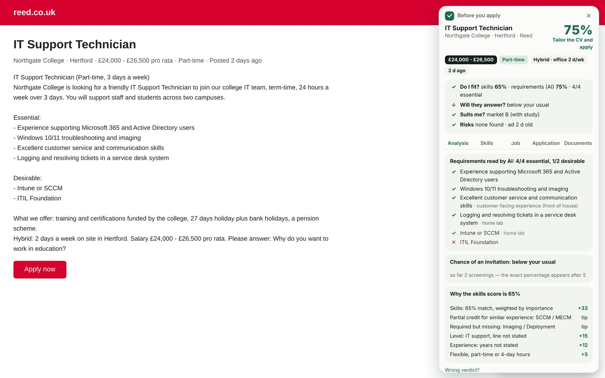

*All screenshots use invented companies and demo data. AI answers in them are fixed sample text.*

## Contents

- [What it does](#what-it-does)
  - [On a job page](#on-a-job-page)
  - [The dashboard](#the-dashboard)
  - [Application session and autofill](#application-session-and-autofill)
  - [The web app on the phone and the laptop](#the-web-app-on-the-phone-and-the-laptop)
  - [Google Sheet, Gmail and Telegram](#google-sheet-gmail-and-telegram)
- [How it works](#how-it-works)
- [Privacy](#privacy)
- [Install](#install)
- [Development](#development)

## What it does

### On a job page

Open a job on LinkedIn, Indeed, Reed, Totaljobs, CV-Library, CWJobs, Glassdoor, jobs.ac.uk or one of a dozen other boards. A badge in the corner shows the score. Click it and the panel opens.

**At the top**, the facts that decide most things: pay (also read from LinkedIn's chips such as *35K GBP/yr*), part-time or full-time, hybrid or remote with office days, the ad's age and how many people applied. Under them, four questions:

| Question | What answers it |
| --- | --- |
| **Do I fit?** | Two scores side by side. The skills score compares the tools in the ad with your skill levels. The requirements score uses the ad's requirements, read by AI or from its sections and checked against your evidence for each skill: real work counts 1, a home lab 0.6, a similar tool 0.4. |
| **Will they answer?** | Your own history: channel, level, ad age, applicants, tailored CV. Under 5 screenings it only says *above / below / about your usual* and why; the percentage appears from 5 screenings. |
| **Suits me?** | Market B (alongside study) or A (full-time, only if worth a study break: a known company, the salary threshold, a growth path), office days, and hard blocks such as a driving licence. |
| **Risks** | An agency or a job board posting under its own name (DICE, CV-Library…) hiding the employer, an old ad, 100+ applicants, a repost, a job you already applied for through another site. |

**Five tabs** do the rest without opening the dashboard:

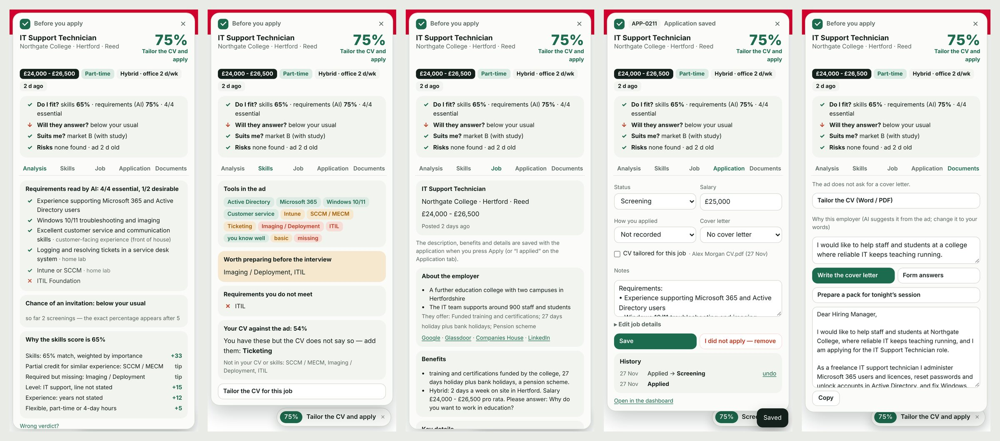

- **Analysis.** Each requirement marked ✓ ~ ✕ ?, the chance of an invitation, why the skills score is what it is, and *Wrong verdict?* to collect cases for tests.
- **Skills.** Tools in the ad: the ones you know well, know basically, or lack. Also requirements you do not meet, what to prepare for the interview, and your CV against the ad (which of your skills the CV does not mention).
- **Job.** Pay, posting, benefits, key details and the full description. What the employer does and offers (from the ad), with links to Google, Glassdoor, Companies House and LinkedIn.
- **Application.** Status, salary, how you applied, the cover letter you sent, notes and the job details. The history has *undo* on every change, *I applied — save it* and *I did not apply — remove*.
- **Documents.** *Tailor the CV* as Word or PDF, a cover letter written from your facts, answers to the form questions, and *Prepare a pack for tonight's session*.

Pressing *Apply* on the site saves the application by itself, with the description, benefits, contacts, the CV you used and how you applied.

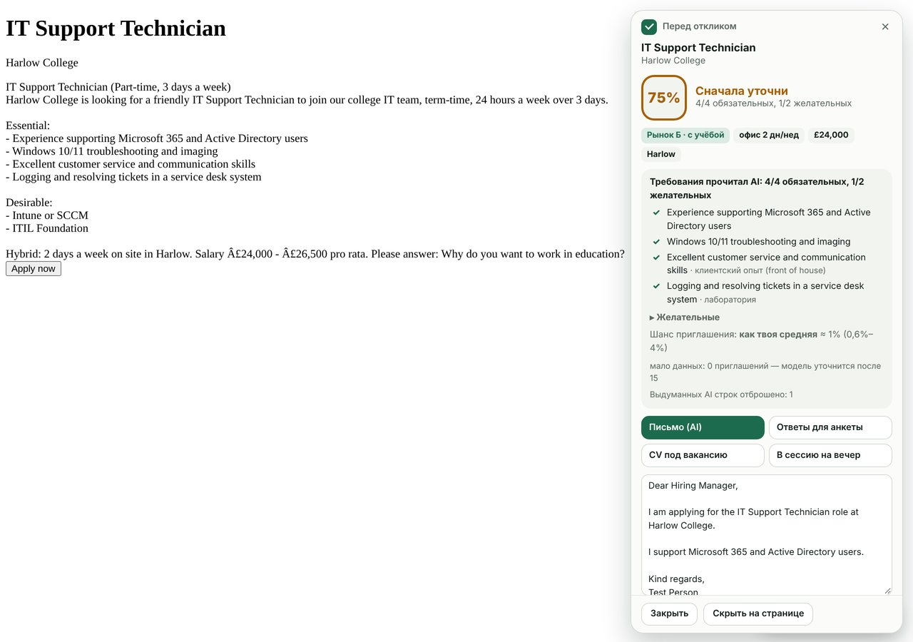

The letter is written only from your facts. The reason for wanting this employer is suggested from the ad, and you can edit it before writing. The letter comes out complete: no placeholders. Any tool it names that is not in your facts is flagged.

The toolbar popup checks the page you are on, adds it by hand, fills in a form or opens the session and the dashboard.

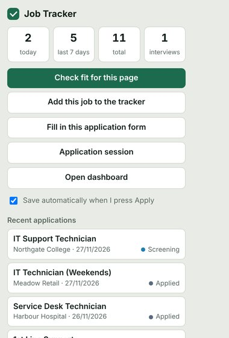

### The dashboard

**Progress** is the first screen. It shows:
- the week against your targets for markets A and B;
- what to do now: follow-ups due after 4 working days, next steps;
- the last 30 days against the 30 before;
- what works: answer rates by channel, tailored against standard CV;
- the week's plan with ticks, and the latest applications.

Detailed statistics are folded underneath.

The **assistant** on the same page answers *What should I do today?*, *How did this week go?*, *Make a plan for the week* (the plan lands in the week's tasks) and questions about your applications. The tracker counts the numbers; AI only talks about them. A question such as *how many did I send to schools this month?* first runs a query on your data.

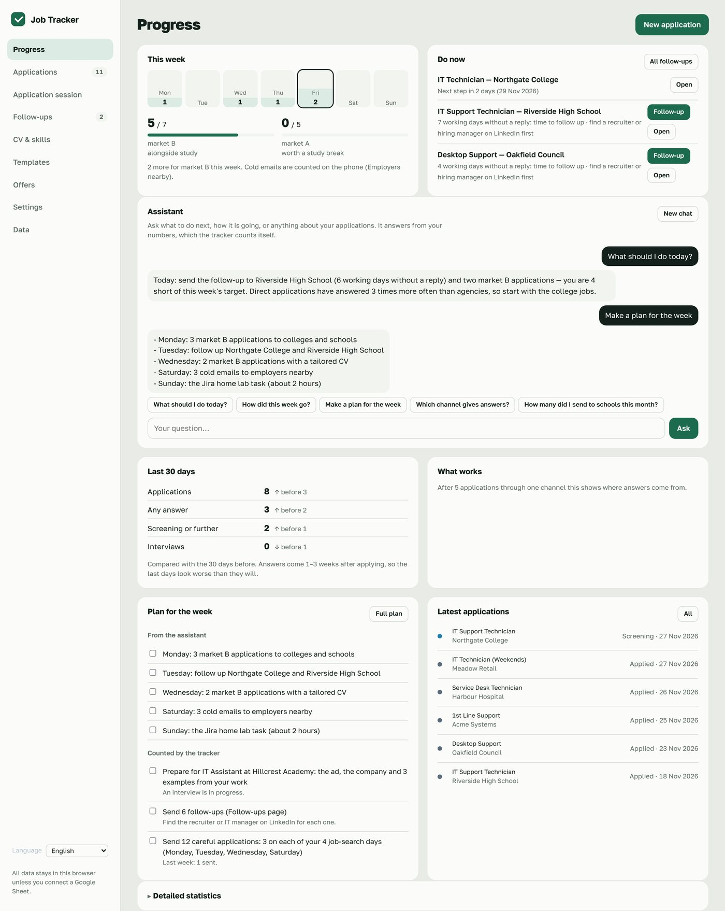

**Applications** is a table with search and filters by status, source and role type. Each row opens a card with the follow-up message, the job details, the CV and letter for that job, and the history.

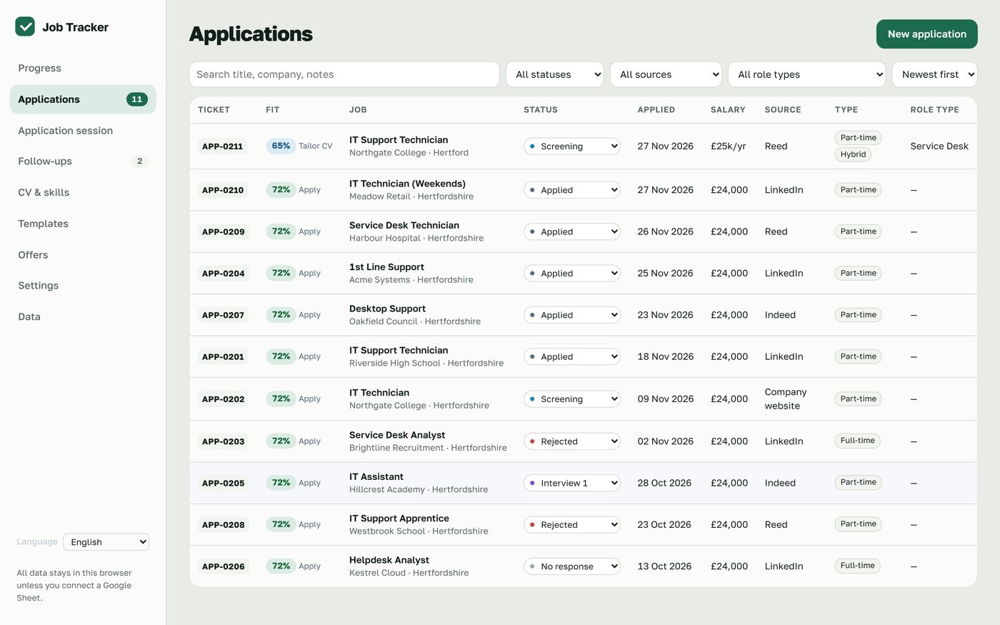

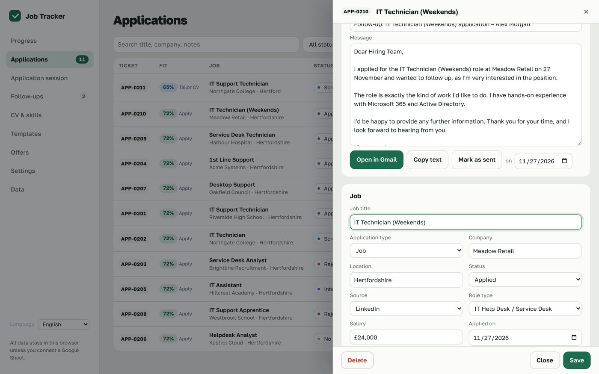

**CV & skills.** Drop in a PDF or Word CV. It is read in the browser and never uploaded:
- skill levels are set from it;
- it gets an ATS check (readable text, contacts, sections, length, action verbs, numbers, dates).

*Facts about you* is the only source the AI writes from. *What you lack most often* lists the tools your jobs ask for that you do not have, each with a home lab task of about an hour. *Done* marks the skill as home lab, so Fit for those jobs goes up and you can put it in your CV honestly.

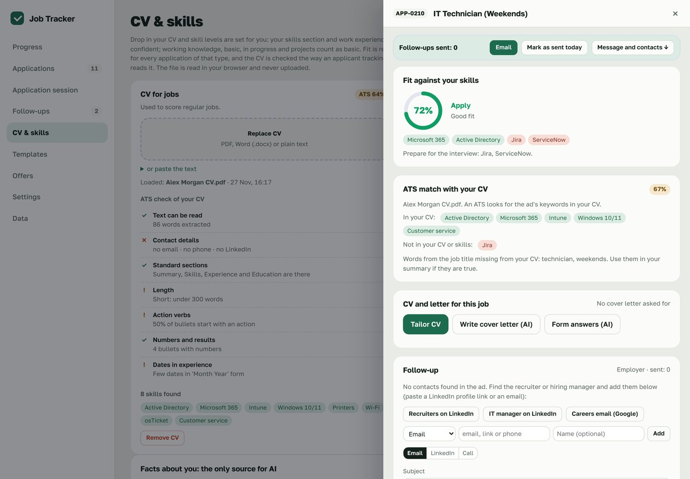

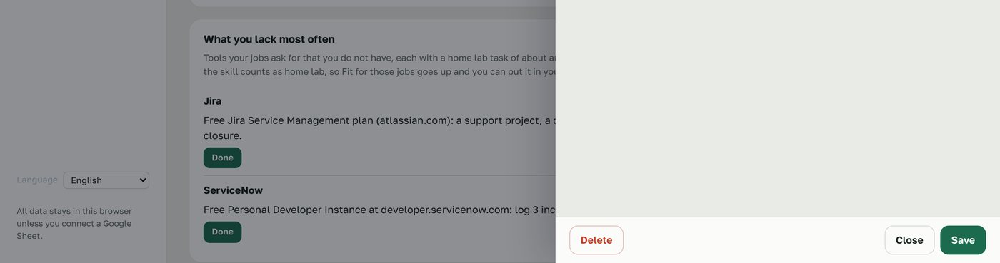

The other pages:
- **Follow-ups:** who to write to and when, with the message ready.
- **Templates:** a cover letter, a cold email, a LinkedIn note and form answers.
- **Offers:** salary against commute, holidays and training, and an effective hourly rate.
- **Internships:** placement rules from your university, checked against every internship.
- **Settings:**
  - first the settings file (import everything at once), then the AI key;
  - markets A and B (weekly targets, salary threshold, companies worth a study break);
  - days you can work, details for application forms, follow-up signature, the Google Sheet and the phone link.

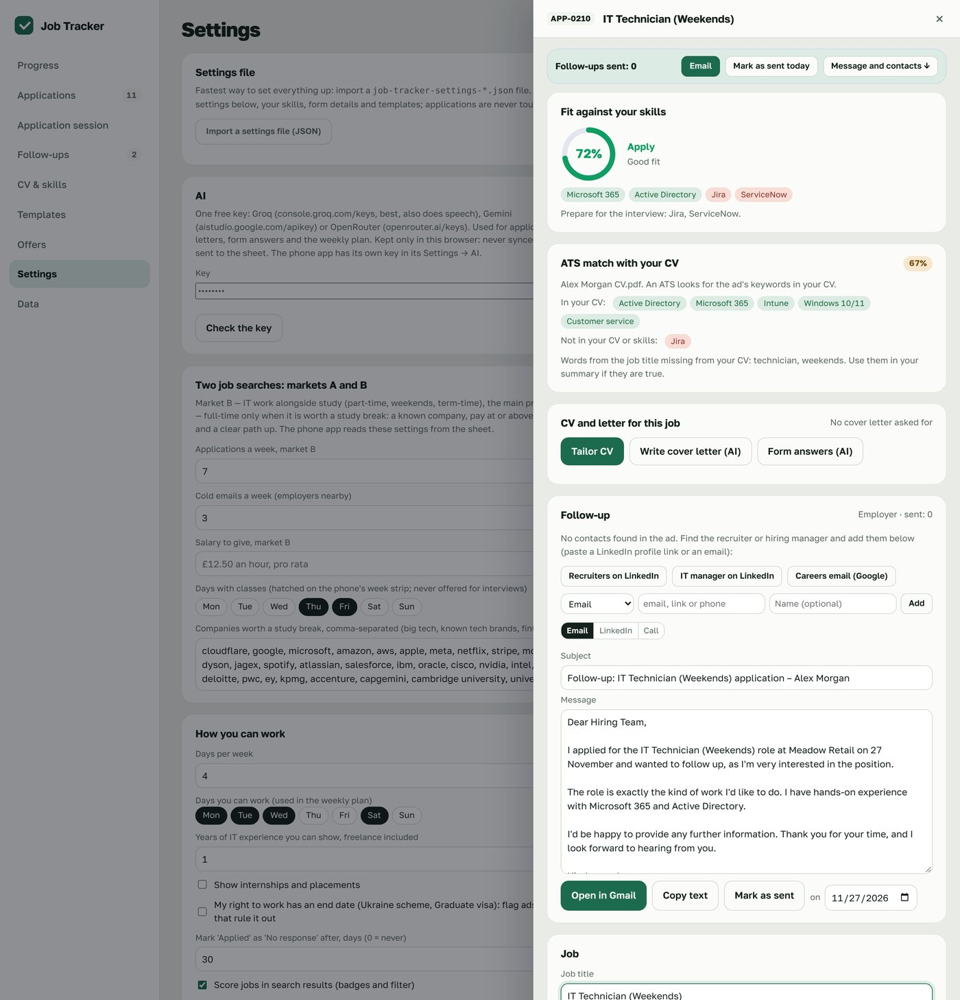

### Application session and autofill

For evenings at the PC. During the day you put jobs *for tonight* from the job panel or *for later* on the phone. For each job a pack is prepared in advance: your CV reordered for the ad as a Word file, a cover letter, and answers to the ad's own questions and the usual form questions.

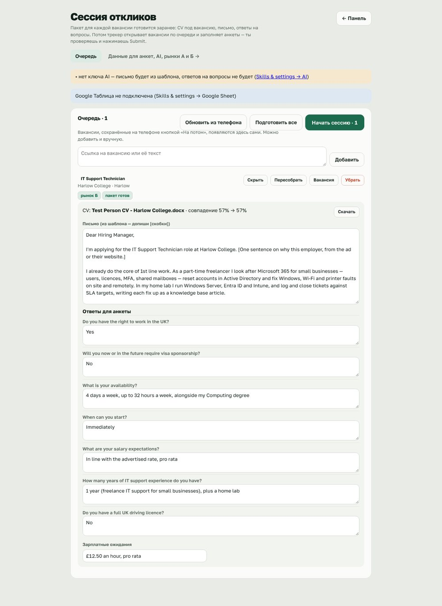

*Start the session* opens the jobs one by one. On the application form, *Fill in this application form* fills in what it can:
- your name, contacts, right to work, sponsorship, notice and salary;
- the letter and the answers;
- which CV file to attach.

Anything it is unsure of is outlined in orange, what is left for you in red. You check and press *Submit* yourself. The application is recorded with the time it took, and the next job opens.

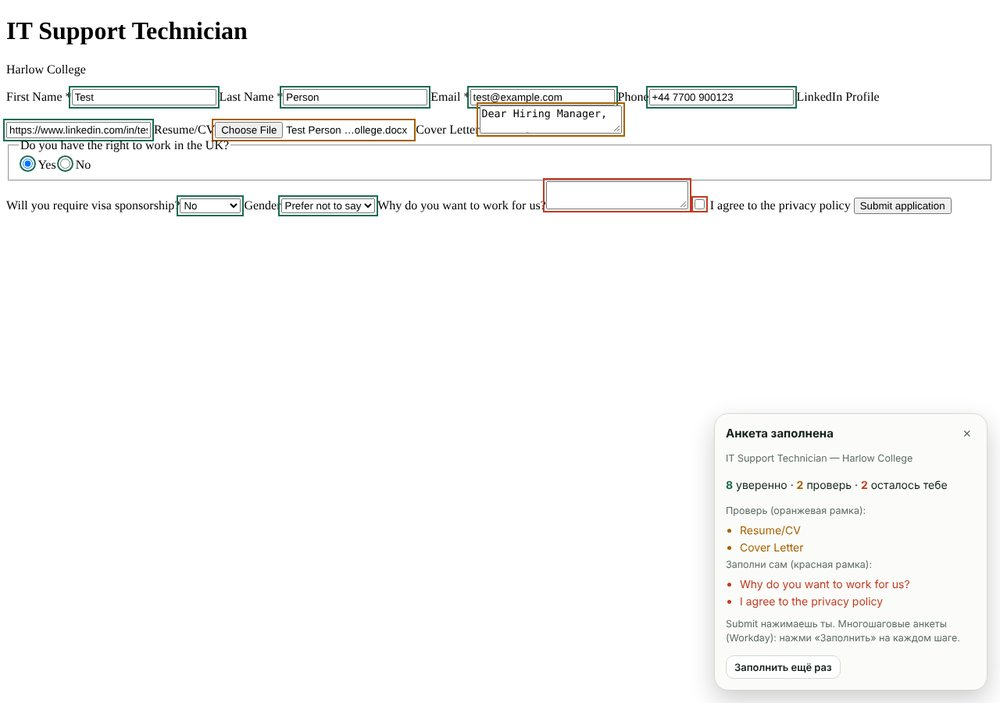

### The web app on the phone and the laptop

The same data, through your Google Sheet. It installs from Chrome's menu, you can share a job to it from the LinkedIn, Indeed or Reed apps, and it is locked with a PIN (the data on the device is encrypted). Russian and English.

| Today | Check a job | Statistics | More |
| --- | --- | --- | --- |
| 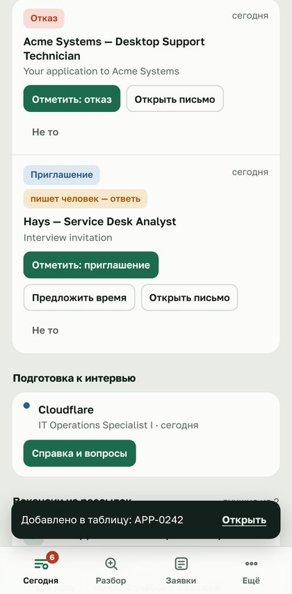 | 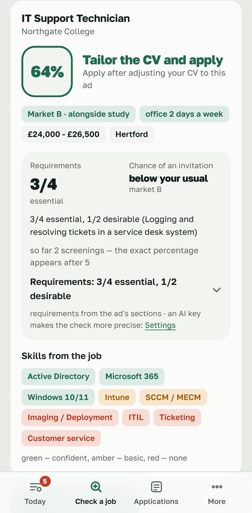 | 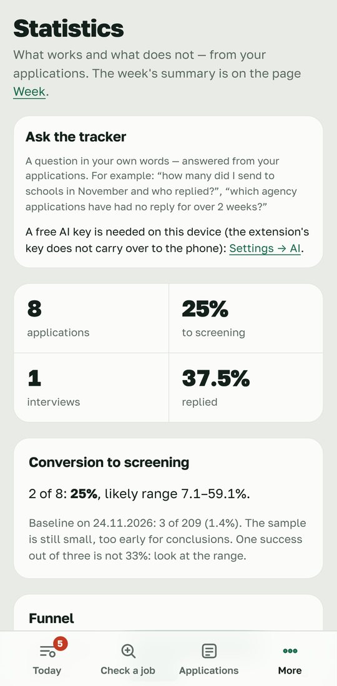 | 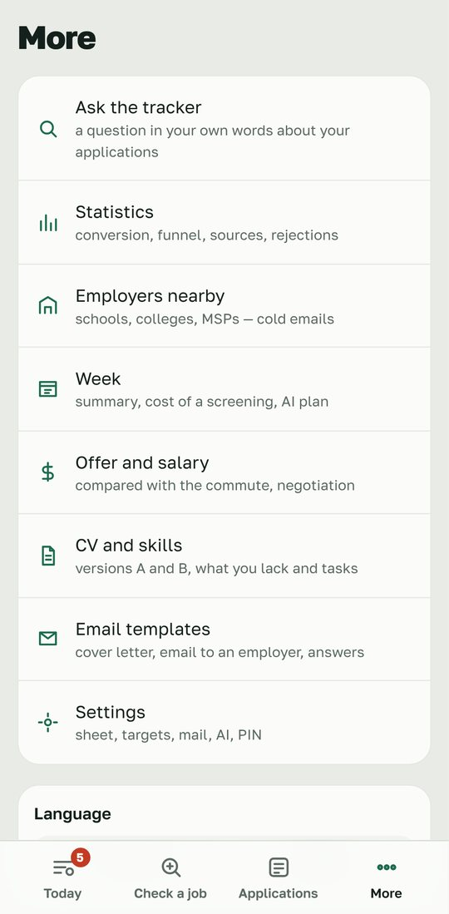 |

What each page does:
- **Today:** the week against the targets with study days hatched, then the to-do list:
  - rejections and invitations from Gmail, applied with one tap;
  - interview slots from your calendar, follow-ups with the email ready, the best jobs from alert emails;
  - a voice note after a call that becomes a status, a next step and a calendar event.
- **Check a job:** paste a link or the ad text. It gets the same score as in the extension, a CV tailored to the ad and a cover letter, and *For later* sends it to the PC session.
- **Statistics:** conversion to screening with a likely range, the funnel, sources, agency against direct, tailored against standard CV, fast rejections, salaries, and *Ask the tracker*.
- **Week:** a summary and the cost of one screening by channel.
- **Employers nearby:** schools, colleges, hospitals and IT companies from OpenStreetMap on a map, with cold emails and reminders.
- **Also:** CV and skills, an offer and salary page, email templates.

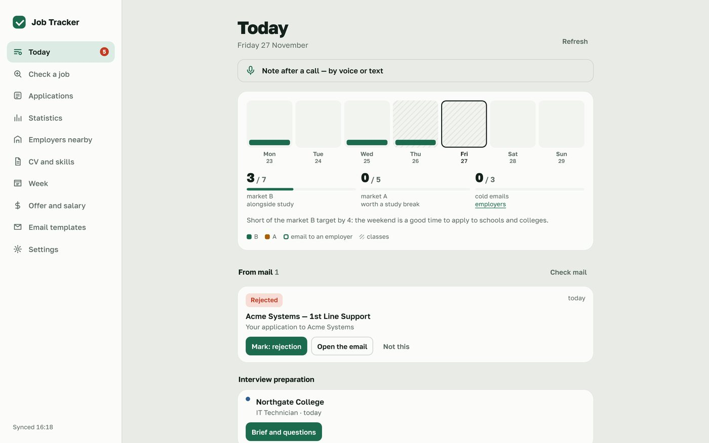

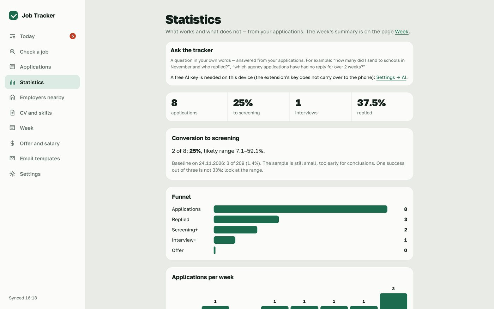

### Google Sheet, Gmail and Telegram

The Apps Script in [`google-sheets/Code.gs`](google-sheets/Code.gs) turns your sheet into the sync hub. It also does background work, without changing anything in your mailbox:
- reads job emails: rejections, invitations, tests and offers are matched to applications, and newsletters and digests are ignored;
- adds applications you forgot to save, from *thank you for applying* emails;
- picks the best jobs out of LinkedIn, Indeed and Reed alert emails;
- watches the vacancy pages of employers you wrote to;
- sends a weekly email on Sundays.

The **Telegram bot** sends:
- invitations, offers and replies from people as they arrive;
- a morning summary at 8:30 and tomorrow's interviews at 18:00.

It is quiet at night. You can also write to it: `/today`, `/stats`, *chart by weeks / sources / funnel / salaries* (sent as a picture), or any question in your own words. Questions need an AI key, added from the sheet's menu.

## How it works

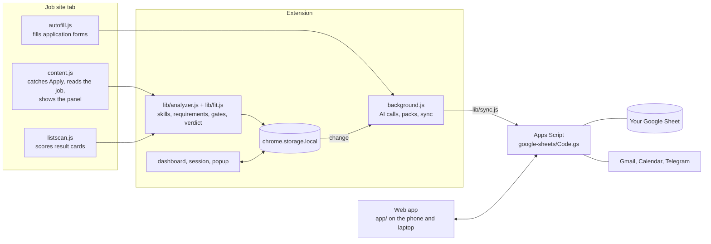

The rule throughout: **AI extracts and drafts, code computes.**

**Scoring and the verdict.** The skills score works from a dictionary of about 100 tools. It weights each tool by where the ad mentions it (requirements, desirable) and by your level for it, and adjusts for seniority, years asked for and constraints. Gates then rule a job out (a required licence, years far above yours, a senior title) or flag questions. The verdict is *Apply*, *Tailor the CV and apply*, *Check first* or *Better not to apply*. Records without a real ad are recognised and shown as *?* instead of a number (`lib/quality.js`).

**Requirements and Fit** (`lib/fit.js`):
- requirements come from AI or from the ad's sections;
- any line AI returns that is not in the ad is dropped;
- Fit = 75% essential + 25% desirable, weighted by your evidence for each skill.

**Chance of an invitation** (`lib/chance.js`) is naive Bayes in odds form over your own closed applications, smoothed towards your base rate. That way, one success in three never reads as 33%.

**AI** (`lib/llm.js`) works with a free Groq, Gemini or OpenRouter key:
- contact details are stripped from every prompt;
- JSON answers are checked by code;
- answers are cached, so a job is read once;
- nothing is sent anywhere by itself: you send every letter and press every *Submit*.

**Sync.** Every change bumps a revision; the service worker pushes changed applications a few seconds later and pulls every 10 minutes. A row edited in the sheet more recently wins for the fields people edit there. Every request carries a random token kept in the script's properties.

**Languages.** The extension is written in English and translated to Russian by `lib/i18n.js`. The web app is written in Russian and translated to English by `lib/en.js`.

## Privacy

- **Where data lives.** Applications stay in your browser unless you connect your own sheet. There is no server and no analytics.
- **AI keys** stay on the device: in `chrome.storage.local` in the extension, encrypted with your PIN in the web app. The Telegram bot's optional key is kept in your script's properties. Keys are never in exports, the sheet or the repository.
- **Job sites.** The extension reads the job you have open and never fetches LinkedIn pages in the background. Sites with bot protection (Totaljobs, CWJobs) are never fetched at all.
- **Gmail** is read-only: nothing is sent, labelled or archived.

## Install

**The extension**
1. Download or clone this repository.
2. Open `chrome://extensions`, turn on **Developer mode**, choose **Load unpacked** and select the folder.
3. In **Settings**, import a settings file or fill in markets A and B, the days you can work and the details for application forms.
4. In **Settings → AI**, add a free key from [Groq](https://console.groq.com/keys).
5. In **CV & skills**, upload your CV.

**The Google Sheet (optional, about 5 minutes)**
1. Create a sheet at [sheets.new](https://sheets.new) and open **Extensions → Apps Script**.
2. Replace the code with [`google-sheets/Code.gs`](google-sheets/Code.gs), save, select `setup` and press **Run**. Approve access: it is your own script.
3. **Deploy → New deployment → Web app**, execute as *Me*, access *Anyone*, and copy the `/exec` URL.
4. In the sheet, **Job Tracker → Show sync token**.
5. In the extension, **Settings → Google Sheet**: paste the URL and token, then press **Sync now**.

**The web app.** `node scripts/build-app.js` builds `dist-app/` for any static host (GitHub Pages deploys it from `main`). In the extension, **Settings → Phone app** gives a link that connects the phone in one tap. The language switch is under **More**.

**Telegram (optional)**
1. In Telegram, send `/newbot` to [@BotFather](https://t.me/BotFather), then send `/start` to your new bot.
2. In the sheet, choose **Job Tracker → Telegram: connect** and paste the token.
3. For questions in your own words, choose **Job Tracker → Telegram: AI key for questions**.
4. Write `/help` to the bot.

## Development

No build step and no runtime dependencies for the extension: Chrome loads the files as they are.

```bash
npm test          # 203 unit tests with node:test (Node 20+)
```

```bash
npm run check     # manifest references, script syntax, no committed token
```

The unit tests load the real `lib/` files with a fake `chrome.storage`, and test the sync against an in-memory stand-in for the Apps Script. They also cover the Apps Script's own helpers (email parsing, Telegram stats and charts) in a sandbox. GitHub Actions runs both commands on every push.

The browser tests use Playwright with Chromium:
- `tests/e2e/panel.js`: the job panel and every tab;
- `tests/e2e/autofill.js`: the session and a form;
- `tests/e2e/phone.js`: the web app.

The screenshots in this file come from one script:

```bash
node tests/e2e/screens.js            # writes raw shots to docs/screenshots/.raw
```

It mocks the job pages, the sheet and the AI, and reports any Russian text left on a page.

### Project structure

```
manifest.json            Manifest V3
background.js            service worker: AI on job pages, the assistant, packs, autofill data, sync
content.js               job pages: Apply detection, extraction, the panel with tabs
listscan.js              search results: score badges and a filter panel
autofill.js              application forms: fills them in from your details and the pack
popup.html/js            toolbar popup
dashboard.html/js/css    Progress, applications, follow-ups, CV & skills, templates, offers, settings
session.html/js          the application session
tailor.html/js/css       Tailor CV (Word and PDF)
lib/analyzer.js          skills dictionary, salary parser, sections, skills score, gates, verdicts
lib/quality.js           cleans descriptions, recognises forms, lists and junk titles
lib/fit.js               requirements and the precise Fit
lib/chance.js            chance of an invitation from your history
lib/market.js            markets A and B, office days, intermediaries, form answers
lib/llm.js               AI client: requirements, letters, answers, employer summary
lib/assistant.js         the assistant's numbers and rules
lib/review.js            weekly review, cost of a screening, ask-the-tracker queries
lib/learn.js             what you lack most often, with home lab tasks
lib/packs.js             application packs for the session
lib/autofill.js          form field matching
lib/cv.js, cvread.mjs    CV sections, ATS check; reads PDF and Word in the browser
lib/tailor.js, docx.js, cvpdf.js   tailored CV and its files
lib/store.js, sync.js    storage, history with undo, Google Sheets sync
lib/i18n.js, en.js       Russian for the extension, English for the web app
app/                     the web app (phone and laptop), PIN vault, service worker
google-sheets/Code.gs    Apps Script: sync, Gmail, alerts, weekly email, Telegram bot
scripts/                 app build, checks, backup audit
tests/                   unit tests and Playwright browser tests
```

## Roadmap

- One design system shared by the extension and the web app.
- Telegram buttons that change a status from the message (*follow-up sent*, *rejected*).
- An optional self-hosted Telegram bot (Docker) with instant replies.
- Move the analyser to TypeScript and split `dashboard.js` into modules.

## Licence

Copyright © 2026 Oleh Poratui. All rights reserved.
